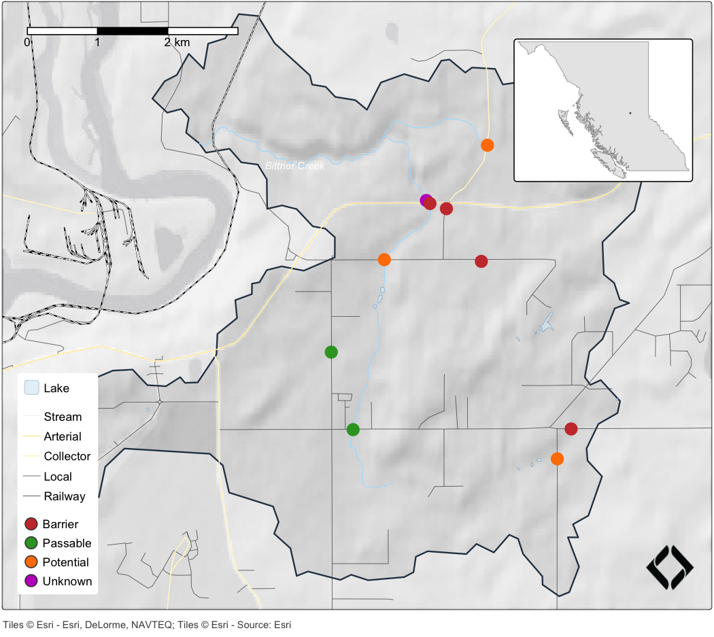

# gq 

<!-- badges: start -->
[](https://lifecycle.r-lib.org/articles/stages.html#experimental)
<!-- badges: end -->

> One set of map styles for QGIS field projects, report figures and web maps

gq keeps the map styles of New Graph's QGIS field projects in one registry and hands them to the other tools a map is drawn with: tmap for figures in reports and MapLibre GL for web maps. A crossing classed as a barrier is the same red in the field project, the report and the web map, so the maps behind fish passage and restoration planning read the same wherever they are seen. Change a style in the registry and every map that reads it follows.



*PSCIS fish passage assessments in the Bittner Creek watershed, classified by barrier status. The crossings, roads and lakes are drawn straight from the gq registry, and the streams and railway take their colours from it; the code is in the [Getting started](https://www.newgraphenvironment.com/gq/articles/gq-intro.html) article.*

## Installation

```r
pak::pak("NewGraphEnvironment/gq")
```

gq is under active development and its functions change between releases (see [NEWS](https://www.newgraphenvironment.com/gq/news/index.html)). Pin a release for reproducible work: `pak::pak("NewGraphEnvironment/gq@vX.Y.Z")`.

## Example

Load the registry once, then ask for a layer's style by name. For tmap, a style comes back as arguments for `do.call()`:

```r
library(gq)
reg <- gq_reg_main()

gq_tmap_style(reg, "lake")
#> $fill
#> [1] "#dcecf4"
#>
#> $fill_alpha
#> [1] 0.7
#>
#> $col
#> [1] "#1f78b4"
#>
#> $lwd
#> [1] 0.2

# tm_shape(lakes) + do.call(tm_polygons, gq_tmap_style(reg, "lake"))
```

A classified layer carries a colour for each class, and the same registry builds a MapLibre GL expression with `gq_mapgl_classes()`:

```r
gq_tmap_classes(reg, "crossings_pscis_assessment")$values
#>   BARRIER  PASSABLE POTENTIAL   UNKNOWN
#> "#ca3c3c" "#33a02c" "#ff7f00" "#bf2ac4"
```

For QGIS itself, `gq_style_qml()` returns the path to the style file QGIS wrote, with nothing lost in translation.

## Learn more

- [Getting started](https://www.newgraphenvironment.com/gq/articles/gq-intro.html): the registry, a tmap map and a MapLibre GL map of Bittner Creek, and extracting styles from a QGIS project.
- [Map composition with gq and tmap](https://www.newgraphenvironment.com/gq/articles/gq-tmap-composition.html): a full report map with basemap, legend, scale bar, logo and keymap, for a Neexdzii Kwa subbasin.
- [Function reference](https://www.newgraphenvironment.com/gq/reference/)

## Ecosystem

| Package | Role |
|---|---|
| **gq** | Shared map symbology (this package) |
| [fresh](https://www.newgraphenvironment.com/fresh/) | Stream network modelling engine: segment, classify, cluster, aggregate |
| [link](https://www.newgraphenvironment.com/link/) | Intrinsic habitat models: develop, test and communicate |
| [wet](https://www.newgraphenvironment.com/wet/) | Stream flow and water temperature for BC's Freshwater Atlas |
| [flooded](https://www.newgraphenvironment.com/flooded/) | Delineate floodplain extents from DEMs and stream networks |
| [drift](https://www.newgraphenvironment.com/drift/) | Track land cover change within floodplains over time |
| [floodplains](https://www.newgraphenvironment.com/floodplains/) | Floodplain and land cover change modelling for BC watershed groups |
| [stac_floodplains_bc](https://www.newgraphenvironment.com/stac_floodplains_bc/) | STAC catalogue of floodplain land cover change in BC, 2017-2023, by watershed group |
| [cd](https://www.newgraphenvironment.com/cd/) | Climate departure analysis from ERA5-Land reanalysis |
| [fly](https://www.newgraphenvironment.com/fly/) | Estimate airphoto footprints and select photos that cover a study area |

## Data and methods it builds on

Most registry styles are extracted from New Graph's QGIS field project templates by `gq_qgs_extract()`, which reads the project's XML; the rest are curated by hand. The bundled example data was queried from a database built with [fwapg](https://smnorris.github.io/fwapg/) and [bcfishpass](https://smnorris.github.io/bcfishpass/): streams, lakes and watersheds from the [BC Freshwater Atlas](https://www2.gov.bc.ca/gov/content/data/geographic-data-services/topographic-data/freshwater), modelled habitat and crossings from bcfishpass, and PSCIS assessments, roads and railway from the [BC Data Catalogue](https://catalogue.data.gov.bc.ca/). Basemap tiles are fetched with [maptiles](https://CRAN.R-project.org/package=maptiles), and each tile layer carries its provider's credit for the map.

## Citation

```r
citation("gq")
```

## License

MIT (see [`LICENSE`](https://github.com/NewGraphEnvironment/gq/blob/main/LICENSE)).
